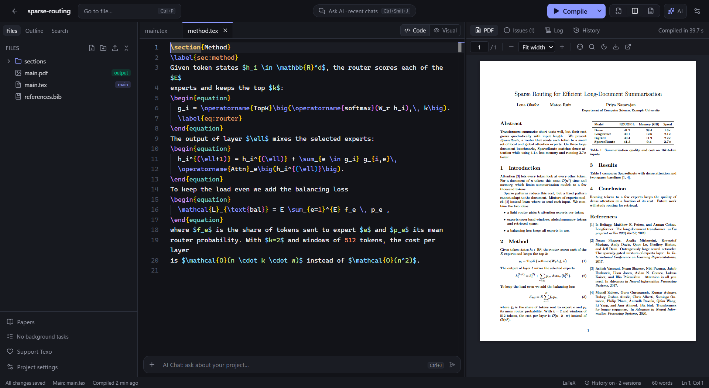
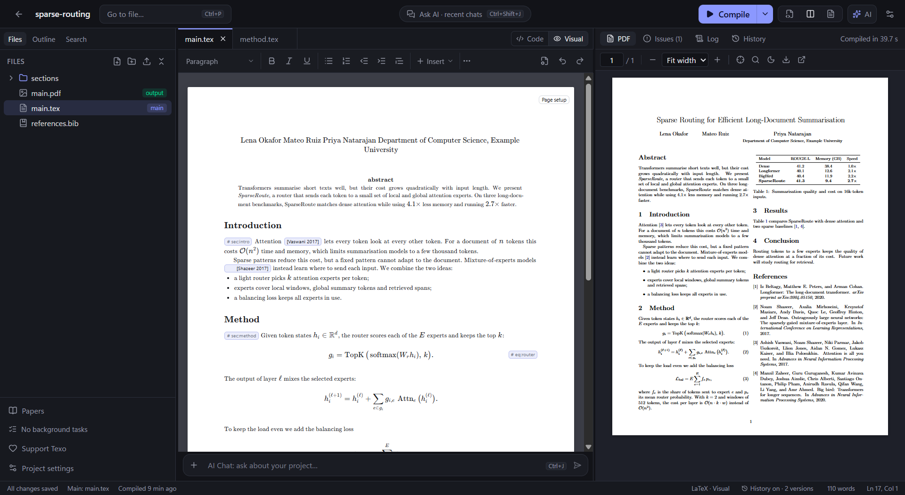
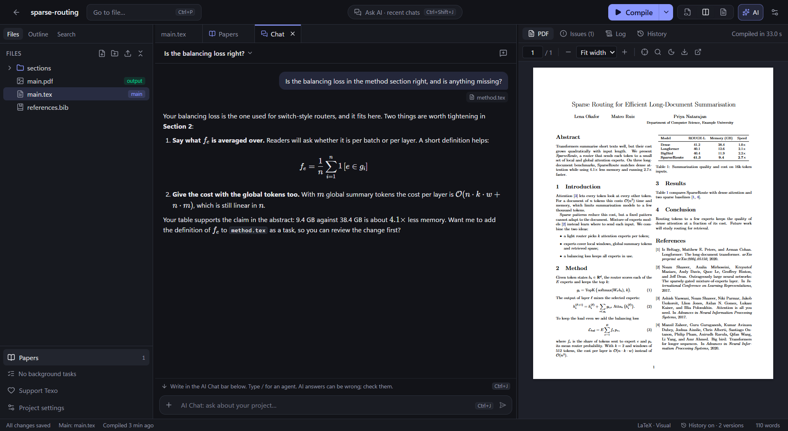
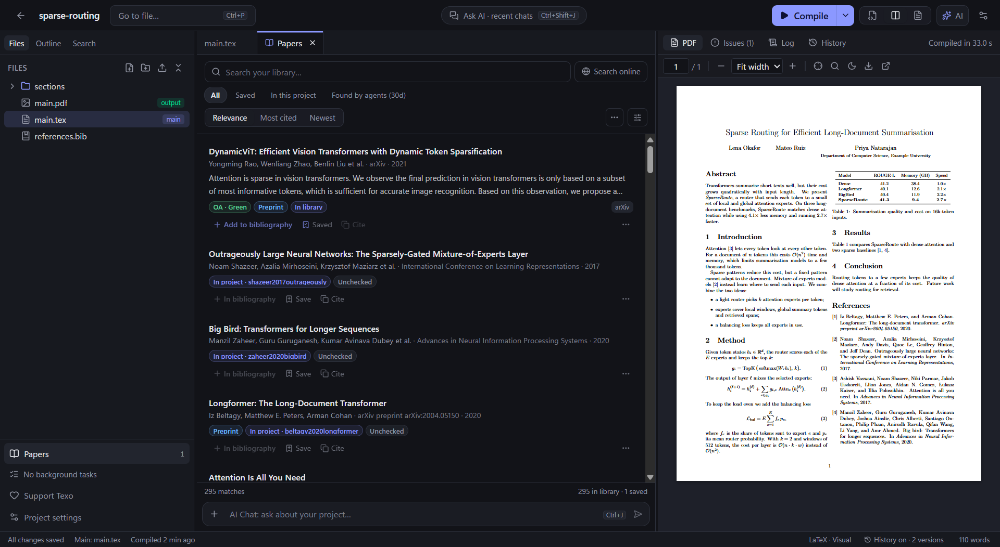

<div align="center">


# Texo

**Write LaTeX on your own computer, with the PDF beside you and an AI that helps when you ask.**

[](https://github.com/codewithdark-git/Texo/releases/latest)

[](LICENSE)

**[Download Texo 1.3 →](https://github.com/codewithdark-git/Texo/releases/latest)**

Free · Works offline · No account · Your projects stay plain folders



</div>

## Why Texo

- 📁 **Your files stay yours.** A project is an ordinary folder on your disk. It still opens in any other LaTeX editor.
- ⚡ **Nothing else to install.** A LaTeX engine comes with the app. If you already have MiKTeX or TeX Live, Texo uses it.
- 👀 **See the result as you write.** Save, and the PDF beside the editor updates. Every error links to the line that caused it.
- ✍️ **Code or Visual.** Write LaTeX source, or switch to Visual mode and write in a rendered page, like a word processor.
- 🤖 **AI help, only if you want it.** Chat about your paper, fix compile errors, get a reviewer-style report, draft your response to reviewers. You bring your own key, and nothing changes until you accept it.
- 📚 **A paper library for all your projects.** Find papers, check your citations and add BibTeX in one click.
- ↩️ **Every change can be undone.** Texo keeps a version history of each project, so anything you or the AI did can be rolled back.

## What's new in 1.3

- **AI opens in editor tabs.** Chat, your agents and every background task open as tabs next to your files.
- **The AI Chat bar** sits under the editor. Ask a question, attach files or pictures, or type **/** to start an agent.
- **Papers:** one library for all your projects, with online search across Semantic Scholar, arXiv and Crossref.
- **Agent progress you can follow:** phases, a plan and a live line of what each agent is doing.
- **A tidier workspace** with smooth motion throughout.

[Read the full release notes →](https://github.com/codewithdark-git/Texo/releases/tag/v1.3.0)

## A tour

### Write in Code or Visual mode

Switch any file between **Code** and **Visual** with one click (or Ctrl+Shift+E). Visual mode shows your document as pages, with rendered maths, tables, figures and citations. A toolbar handles fonts, lists, links and page setup, and you can type Markdown-style shortcuts like `# ` for a heading. Both modes edit the same file, so nothing is lost when you switch.



### Ask the AI about your paper

Write in the **AI Chat bar** under the editor (Ctrl+J). The answer appears in a **Chat** tab, with maths and code rendered. Use **+** to attach files or images, or type **/** for an agent:

- **/fix** compiles your paper and fixes the errors, up to three rounds, until it builds.
- **/review** reviews your paper like a venue's reviewers would (NeurIPS, ICLR, ACL, CVPR, journals, a thesis committee and more), with an area-chair summary.
- **/respond** turns your reviews into a plan you approve, then drafts the response letter.
- **/task** does what you describe, with files and pictures attached.

Agents work in the background. Each one has its own tab showing its progress, and the sidebar shows them all at a glance. When an agent finishes, you review its changes side by side and keep only what you want.



### Find and cite papers

Open **Papers** from the sidebar to search your library as you type, even offline, or search online across Semantic Scholar, arXiv and Crossref (plus OpenAlex with a key). You'll see which papers are already in your project, and you can add a paper to your `.bib` in one click, with Undo. **Check all citations** looks up every entry in your bibliography and flags the ones that don't match.



### And the everyday things

- **Projects:** a dashboard with thumbnails, ten templates (paper, two-column paper, report, thesis, lecture notes, assignment, slides, letter, CV, blank), `.zip` import and export.
- **Editor:** completions for commands, labels, citations and file paths. Also Quick Open (Ctrl+P), search across the project, an outline, a word count, and maths previews on hover.
- **Compiling:** automatic on save, with pdfLaTeX, XeLaTeX or LuaLaTeX. BibTeX and Biber run on their own. The Issues panel explains errors in plain words, and **Fix issues** hands them to the fixer agent.
- **PDF:** zoom, search, dark pages, and double-click to jump to the source (SyncTeX). A fresh `main.pdf` is always saved in your project.
- **History:** Texo saves versions as you work, before each compile and before each AI run. Compare, restore a file or the whole project, or undo an AI run. No git needed.
- **Light and dark themes,** and the window opens where you left it.

## Install

Download the latest version from the **[releases page](https://github.com/codewithdark-git/Texo/releases/latest)**. You don't need to install LaTeX separately.

| System | File | How |
|---|---|---|
| **Windows 10/11** | `Texo_…_x64-setup.exe` | Run it. The installer isn't code-signed yet, so if SmartScreen warns you, choose **More info → Run anyway**. |
| **Linux** (any distribution) | `Texo_…_amd64.AppImage` | Make it executable (`chmod +x`), then run it. |
| **Debian / Ubuntu** | `Texo_…_amd64.deb` | `sudo apt install ./Texo_…_amd64.deb` |

The first time you compile, Texo downloads the common LaTeX packages once (about 90 MB). After that it works offline.

## AI with your own key

The AI features are optional, and Texo has no server of its own. Your requests go straight from your computer to the AI service you pick.

- **NVIDIA is the default, and its key is free:** create one at build.nvidia.com and paste it into **Settings → AI**. Claude, OpenRouter, Groq, Gemini and any OpenAI-compatible service work too.
- Keys stay in your system's credential store. They never appear in settings files, logs or error messages.
- Before anything is sent for the first time, Texo shows you what it sends and where. One switch in Settings turns all AI off.

## Safe by design

- Projects you download can't run their own build scripts until you trust them, and shell escape is always off.
- BibTeX fetched from the internet is checked before it goes into your bibliography, so it can't run code when your paper compiles.
- AI agents work on a private copy of your project. Your files change only after you review and accept their changes.

## Keyboard shortcuts

<details>
<summary>Show the most useful shortcuts</summary>

| Keys | Action |
|---|---|
| Ctrl+Enter | Compile |
| Ctrl+P | Go to a file |
| Ctrl+Shift+F | Search in project |
| Ctrl+Shift+E | Switch between Code and Visual |
| Ctrl+J | Go to the AI Chat bar |
| Ctrl+Shift+J | Ask AI: recent chats and background tasks |
| Ctrl+Shift+A | Open the Chat tab |
| Ctrl+Alt+J | Show the cursor's position in the PDF |
| Double-click PDF | Jump to the source line |
| Ctrl+W / Ctrl+Tab | Close tab / next tab |
| Ctrl+, | Settings |
| Ctrl+Shift+/ | All shortcuts |

</details>

## Support Texo

Texo is free and has no ads. If it helps you, use **Support Texo** in the app (at the bottom of the sidebar, in the app menu or in About) to help fund its development. Starring the repository and telling a friend helps too. ⭐

## Roadmap

- **Next:** Zotero, and a test suite of real arXiv papers.
- **Later:** a Beamer presentation mode, collaboration, Git sync, and macOS.

Ideas and bug reports are welcome in [Issues](https://github.com/codewithdark-git/Texo/issues).

## Build it yourself

<details>
<summary>For developers</summary>

Texo is built with Tauri (Rust) and React. You need Node 24+, pnpm and Rust (stable). On Windows, also the Visual Studio Build Tools with the C++ workload. On Linux, the [Tauri system packages](https://v2.tauri.app/start/prerequisites/#linux).

```bash
pnpm install
```

```bash
pnpm tauri dev
```

```bash
pnpm check
```

```bash
pnpm tauri build
```

`pnpm check` runs the same checks as CI. `pnpm tauri build` makes the installers for your system.

</details>

## License

[MIT](LICENSE)
