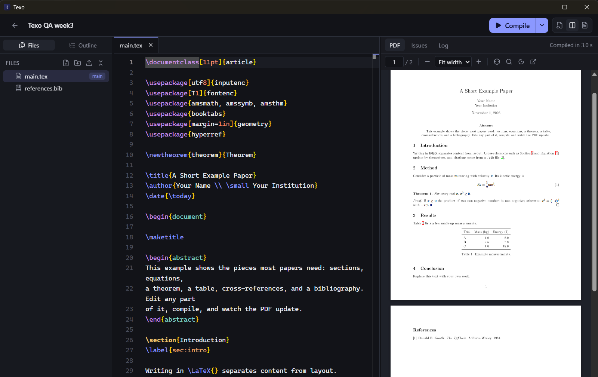

# Texo

**Write LaTeX on your own machine.** Texo is a desktop LaTeX editor for Windows and Linux with a live PDF preview, clear compile errors, and jumps between your source and the PDF. It comes with its own LaTeX engine, so there's nothing else to install, and your projects stay plain folders on your disk.



> **Pre-release.** Texo is in active development toward its first full release (`v0.1.0`). The alpha builds already let you write, compile and preview real papers. An AI writing assistant comes next. [Download the latest alpha →](https://github.com/codewithdark-git/Texo/releases)

## Why Texo

- **Your files, your disk.** A project is an ordinary folder. Texo keeps its own data in a hidden `.texo/` subfolder and never rewrites your sources behind your back.
- **Fast feedback.** Save, and the PDF updates beside the editor. Errors link straight to the line that caused them.
- **Nothing else to install.** A LaTeX engine ([Tectonic](https://tectonic-typesetting.github.io)) ships with the app. If you already use MiKTeX or TeX Live, Texo uses that instead.
- **Works offline.** After the first compile, which fetches the LaTeX packages a document needs, everything stays local. No account and no upload.
- **Safe with other people's projects.** Downloaded projects can't run their own build scripts until you trust them.

## Features

### Projects
- A dashboard of your projects as a list or a grid of first-page thumbnails, with search and sorting.
- Start from a blank or an example paper, or open any existing LaTeX folder. Texo finds the main `.tex` file.
- Rename, duplicate, show in File Explorer, and move to the Recycle Bin.

### Editor
- The Monaco editor (the one inside VS Code) with LaTeX and BibTeX highlighting, folding, sticky section headers, and warnings for look-alike Unicode characters.
- **Completions** for:
  - LaTeX commands, and environments (`\begin{…}` inserts the matching `\end`).
  - `\ref` labels, and `\cite` keys from your `.bib` files (search by key, title or author).
  - Commands you define with `\newcommand`.
  - File paths for `\input`, `\include`, `\includegraphics` and `\bibliography`.
- Autosave, tabs, an outline of the current file, image previews, and a file tree. In the tree you can create, rename and move files, drop files in from File Explorer, and choose the main document.
- Edits made in other apps appear right away. If a file changes on disk while you have unsaved edits, Texo asks which version to keep.

### Compiling
- **Engines:** the built-in Tectonic engine (XeTeX-based), or your installed MiKTeX or TeX Live with pdfLaTeX, XeLaTeX or LuaLaTeX, run through latexmk or directly. BibTeX and Biber run automatically.
- **First launch:** Texo prepares the built-in engine in the background (a one-time download of about 90 MB of common LaTeX packages) and shows the progress in the sidebar.
- **When it runs:** automatically after each save, or with Compile / Ctrl+Enter. A running compile can be stopped.
- **Issues panel:** errors, warnings and layout problems, read from the TeX, BibTeX and Biber logs. Each shows TeX's context and links to its line, and they also appear as squiggles in the editor. Common problems come with plain-language hints.
- **Live log** while compiling, plus the full TeX log.

### PDF
- **Built-in viewer:** fit width or fit page, zoom (Ctrl+mouse wheel too), find (Ctrl+F), selectable text, clickable links, and a dark page mode. It keeps your place when the PDF updates.
- **SyncTeX:**
  - Double-click the PDF to jump to the source line.
  - Press Ctrl+Alt+J to highlight the cursor's spot in the PDF.
- **Always a PDF in your project:** after each successful compile, Texo saves the PDF next to your main file (`main.tex` → `main.pdf`). It's one file, kept up to date, and a failed compile never replaces it. If you already have a file with that name, Texo leaves it alone.

### Shortcuts

| Keys | Action |
|---|---|
| Ctrl+S | Save |
| Ctrl+Enter | Compile |
| Ctrl+Alt+J | Show the cursor's position in the PDF |
| Double-click PDF | Jump to the source line |
| Ctrl+B / Ctrl+I | Bold / italic |
| Alt+Z | Toggle word wrap |
| F2 | Rename in the file tree |

## Install

Download from the [releases page](https://github.com/codewithdark-git/Texo/releases). No separate LaTeX install is needed.

**Windows:** run `Texo_…_x64-setup.exe`. The alpha installers aren't code-signed yet, so SmartScreen may warn you. Choose **More info → Run anyway**. Texo installs for the current user. It needs WebView2, which comes with Windows 11; the installer fetches it on older systems.

**Linux (x86-64):**
- **AppImage** (any distribution): make it executable, then run it.

  ```bash
  chmod +x Texo_*_amd64.AppImage
  ```

  ```bash
  ./Texo_*_amd64.AppImage
  ```

- **Debian / Ubuntu:** install the `.deb` package.

  ```bash
  sudo apt install ./Texo_*_amd64.deb
  ```

The Linux builds need WebKitGTK 4.1, which current GNOME and KDE desktops already have.

## How a project is stored

```
My paper/
├── main.tex
├── main.pdf           # the latest compiled PDF, kept up to date by Texo
├── references.bib
└── .texo/
    ├── project.json   # name, main document, engine
    └── build/         # aux files, logs, SyncTeX data
```

The folder still works in any other LaTeX editor.

## Security

- **Project trust:** a project's `latexmkrc` is Perl code, so it only runs for projects you created in Texo or chose to trust.
- **No shell escape:** shell escape is off for every project, and untrusted projects run the built-in engine in its untrusted mode.
- **Absolute tool paths:** tools run by absolute path, so a project can't substitute its own `pdflatex.exe`.
- **No writing through links:** Texo won't write through links planted in `.texo/`.

## Roadmap

- **Next alpha:** import and export of zip files, more templates, a word count panel, a settings screen.
- **Then:** an AI assistant with your own provider key (OpenAI, Anthropic or a local model), with proposed changes you keep or undo, and Fix / Edit / Proofread with AI.
- **v0.1.0:** version history with restore, and a real-paper compile test suite.
- **Later:** Zotero, Beamer presentation mode, collaboration, Git sync, macOS.

## Development

Requirements: Node 24+, pnpm, and Rust (stable). On Windows, also Visual Studio Build Tools with the C++ workload. On Linux, the [Tauri system packages](https://v2.tauri.app/start/prerequisites/#linux) (WebKitGTK 4.1 and friends).

The dev and build commands download the bundled Tectonic engine into `src-tauri/binaries/` on first use. It's a pinned version, checked against a SHA-256 hash.

```bash
pnpm install
```

```bash
pnpm tauri dev
```

Run every check (typecheck, frontend tests, Rust tests), the same as CI:

```bash
pnpm check
```

With MiKTeX or TeX Live installed, also compile real documents. These tests cover latexmk and the direct engine, SyncTeX, and the security guards:

```bash
pnpm test:tex
```

Build the installers (Windows: NSIS `.exe`, Linux: AppImage and `.deb`):

```bash
pnpm tauri build
```

```bash
pnpm tauri build --bundles appimage,deb
```

Pushing a `v*` tag builds both platforms in CI and attaches the installers to the GitHub release.

### Code layout

| Path | What |
|---|---|
| `src/components/` | Dashboard and shared UI |
| `src/workspace/` | Workspace: file tree, tabs, outline, autosave, compile panel, PDF viewer |
| `src/editor/` | Monaco setup, LaTeX/BibTeX grammars, themes, completions |
| `src/lib/api.ts` | Typed wrappers for the Rust commands |
| `src-tauri/src/project.rs` | Project folders: create, scan, rename, duplicate, saved PDF |
| `src-tauri/src/fsops.rs` | File reads and writes, confined to the project |
| `src-tauri/src/compile.rs` | Finds TeX tools and runs latexmk, the engine, or Tectonic |
| `src-tauri/src/texlog.rs` | Turns TeX/BibTeX/Biber logs into issues |
| `src-tauri/src/synctex.rs` | Reads SyncTeX data for jumps between source and PDF |
| `src-tauri/src/watcher.rs` | Notices file changes made outside Texo |
| `src-tauri/src/symbols.rs` | Finds labels, citations, and commands for completions |

## License

[MIT](LICENSE)
